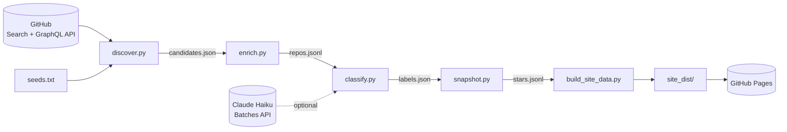

<div align="center">

# ⭐ SkillStars

**A catalog of the most-starred GitHub repos about AI agent skills.**

Every public repo with **10,000+ stars** that gives AI agents or LLM coding tools reusable capabilities:
Claude Code skills, Agent Skills (`SKILL.md`), MCP servers, agent frameworks, coding-agent rules, prompt libraries,
RAG and memory, browser and computer use, evals, and the `awesome-*` lists about them.

[](https://agilealpha1.github.io/SkillStars/)

[](https://github.com/agilealpha1/SkillStars/actions/workflows/pages.yml)

-brightgreen)

[](LICENSE)


[**Browse the catalog**](https://agilealpha1.github.io/SkillStars/) ·
[How it works](#-how-it-works) ·
[Run locally](#-quick-start) ·
[Download the data](#-data-and-license)

</div>

---

## ✨ Features

| | |
|---|---|
| 🗂️ **10 categories** | Every repo gets one fixed category, up to 3 tags and a one-line summary. |
| 📈 **Weekly star gains** | One star snapshot per ISO week, so you can see what's growing fastest. |
| 🆕 **New this week** | Repos that crossed 10k stars since the last refresh are flagged. |
| 🔎 **Search and filter** | Instant client-side search over names, summaries, tags and GitHub topics. |
| 📄 **A page per repo** | Stars, forks, language, license, dates, topics and how the repo was labeled. |
| 📡 **RSS feed** | `feed.xml` lists new arrivals. |
| 📦 **Open data** | The whole dataset, including star history, as one CSV + JSON zip (CC0). |
| 🔁 **Refreshes itself** | GitHub Actions rediscovers, relabels and redeploys every Monday at no cost. |

## 📊 Snapshot

<sub>From the first snapshot on 2026-11-07. The live site always has the current numbers.</sub>

| Candidates found | In scope | Combined stars | Star threshold |
|:---:|:---:|:---:|:---:|
| **1,052** | **621** | **23.8M** | **10,000** |

| Category | What's in it | Repos |
|---|---|---:|
| 🧩 **Claude/Agent Skills** | Claude Code skills, Agent Skills (`SKILL.md`) and other packaged capabilities agents load on demand | 48 |
| 🔌 **MCP Servers** | Model Context Protocol servers, clients, registries and SDKs | 80 |
| 🏗️ **Agent Frameworks** | Libraries and platforms for building and orchestrating LLM agents and multi-agent systems | 94 |
| 💻 **Coding Agents and IDE Rules** | AI coding agents, plus rule/config collections (`.cursorrules`, `AGENTS.md`, `CLAUDE.md`) | 208 |
| 📝 **Prompt Libraries** | Prompts, system prompts and prompt-engineering guides | 18 |
| 🧠 **RAG and Memory** | Retrieval-augmented generation, knowledge bases, vector search, long-term memory | 54 |
| 🌐 **Browser/Computer Use** | Agents that drive browsers, desktops or phones, and web scraping for LLMs | 28 |
| 🧪 **Evals and Observability** | Evaluation, testing, tracing, monitoring and guardrails | 23 |
| 📚 **Awesome Lists** | Curated `awesome-*` lists about agents, skills, MCP, prompts or LLM tools | 25 |
| 🧺 **Other** | In scope but fits none of the above (tool collections, agent apps, datasets) | 43 |

## 🧭 How it works

The same architecture as HackerPapers: **Python pipeline → static JSON → single-page static site on GitHub Pages,
refreshed by GitHub Actions.** No server, no database, no framework.



| Step | Output | What it does |
|---|---|---|
| `discover.py` | `data/candidates.json` | GitHub Search API with star-range splitting (to get past the 1,000-result cap), dedupe by repo id, plus `seeds.txt` |
| `enrich.py` | `data/repos.jsonl` | Metadata and the first 3 KB of each README (GraphQL with a token, raw files without) |
| `classify.py` | `data/labels/labels.json` | Claude Haiku via the Batches API (cached by repo id + README hash), or keyword rules |
| `snapshot.py` | `data/history/stars.jsonl` | One star-count snapshot per ISO week |
| `build_site_data.py` | `site_dist/` | `index.json`, `data/r/*.json`, `categories.json`, `stats.json`, `feed.xml`, the data zip |
| `site/index.html` | — | The whole app: vanilla JS, relative paths, works under `/SkillStars/` |

## 🚀 Quick start

Python 3.10+ (CI uses 3.12) and a single dependency:

```bash
git clone https://github.com/agilealpha1/SkillStars.git
cd SkillStars
make install                            # pip install -r requirements.txt  (just `requests`)

make build && make serve                # build from the committed data/, open http://localhost:8000/
```

To refresh the data yourself:

```bash
export GITHUB_TOKEN=$(gh auth token)    # optional; 30 searches/min instead of 10, and GraphQL
export ANTHROPIC_API_KEY=sk-ant-...     # optional; without it, keyword rules label repos

make update && make serve               # refresh everything, then serve
```

`make update` runs `deploy/update.sh` (discover → enrich → classify → snapshot → validation build) and then
`make build`. Without a token, discovery takes about 8 minutes because of the 10 searches/minute limit. Search
pages are cached in `.cache/search/` for 20 hours, so an interrupted run resumes where it stopped
(`python3 pipeline/discover.py --max-seconds 120` stops early on purpose).

<details>
<summary><b>All make targets and handy commands</b></summary>

| Command | Does |
|---|---|
| `make install` | Install Python dependencies |
| `make update` | Full refresh, keeping old data on failure |
| `make build` | Rebuild `site_dist/` from `data/` only |
| `make serve` | Serve `site_dist/` on `http://localhost:8000/` (`PORT=` to change) |
| `make test` | Run the unit tests |
| `make discover` / `enrich` / `classify` / `snapshot` | Run a single pipeline step |
| `make clean` | Remove build output and caches |
| `python3 pipeline/classify.py --dry-run` | Print the prompt and a cost estimate without calling the API |
| `python3 pipeline/build.py` | Snapshot + build in one go |

</details>

<details>
<summary><b>Environment variables</b></summary>

| Variable | Default | Purpose |
|---|---|---|
| `GITHUB_TOKEN` | none | Higher search rate limit and GraphQL enrichment |
| `ANTHROPIC_API_KEY` | none | Label with Claude Haiku instead of keyword rules |
| `SS_MIN_STARS` | `10000` | Star threshold for inclusion |
| `SS_LABEL_MODEL` | `claude-haiku-4-5` | Model used by `classify.py` |
| `SS_CLASSIFY_MAX_WAIT` | `1800` | Seconds `classify.py` may spend collecting and waiting on batches |
| `SS_BASE_URL` | `./` | Absolute site URL used in the feed (set by CI) |

</details>

## 🎯 Scope and taxonomy

**"AI skill repo"** = a repo that gives agents or LLM coding tools reusable capabilities.

Inclusion rule: `stargazers_count >= 10000`, not archived, not a fork (`SS_MIN_STARS` overrides the threshold).

The categories are fixed in [`pipeline/taxonomy.py`](pipeline/taxonomy.py). Bump `TAXONOMY_VERSION` after changing
them to relabel everything.

| Labeling | How |
|---|---|
| **With `ANTHROPIC_API_KEY`** | Claude Haiku decides scope, category, up to 3 tags and a one-line summary. |
| **Without it** | Keyword rules: name/description hits weigh 5, topics 1, README at most 2, plus a scope gate that ignores padded topics. Deliberately conservative but rougher than the LLM. |

Each repo page shows which method labeled it.

> **Missing a repo?** Add it to [`pipeline/seeds.txt`](pipeline/seeds.txt). Seeds are always in scope.
> Wrong category? Open an issue.

## 💸 Costs

Target: **\$0**, apart from a few cents of Haiku.

| Item | Cost |
|---|---|
| GitHub Actions (public repo), GitHub Pages, GitHub API with the built-in token | free |
| Claude Haiku, first full labeling (~1,050 candidates, ~1.6M input tokens at Batches API prices) | ~\$1, once |
| Claude Haiku, weekly (only repos that are new or whose README excerpt changed) | typically \$0.05–0.25 |
| No `ANTHROPIC_API_KEY` | \$0 (keyword rules) |

`classify.py` prints the estimate before submitting. `SS_LABEL_MODEL` switches the model.

## 🧪 Tests

```bash
make test        # python3 -m unittest discover -s pipeline/tests
```

Covers discovery dedupe and star-range splitting, the classification fallback and label cache retention, snapshot
idempotence, `deploy/update.sh` rollback, and the build output schema (also enforced at build time by
`build_site_data.validate()`). CI runs them before every deploy.

## 📁 Project layout

```
SkillStars/
├── .github/workflows/pages.yml   weekly refresh + Pages deploy
├── data/                         committed dataset (the source of truth)
│   ├── candidates.json           every repo discovery found
│   ├── repos.jsonl               metadata + README excerpts
│   ├── labels/labels.json        category, tags, summary per repo (cached)
│   └── history/stars.jsonl       weekly star snapshots
├── deploy/update.sh              full refresh with rollback
├── pipeline/                     discover, enrich, classify, snapshot, build + tests
├── site/index.html               the single-page app
├── Makefile
└── requirements.txt
```

## 📜 Data and license

- **Code:** [MIT](LICENSE).
- **Data:** the site's dataset is published as `download/skillstars-data.zip` (CSV + JSON + full star history)
  under **CC0 1.0**.
- Repo names, descriptions and README excerpts belong to their authors.

<div align="center">
<sub>If SkillStars helped you find something useful, a ⭐ on the repo is appreciated.</sub>
</div>
